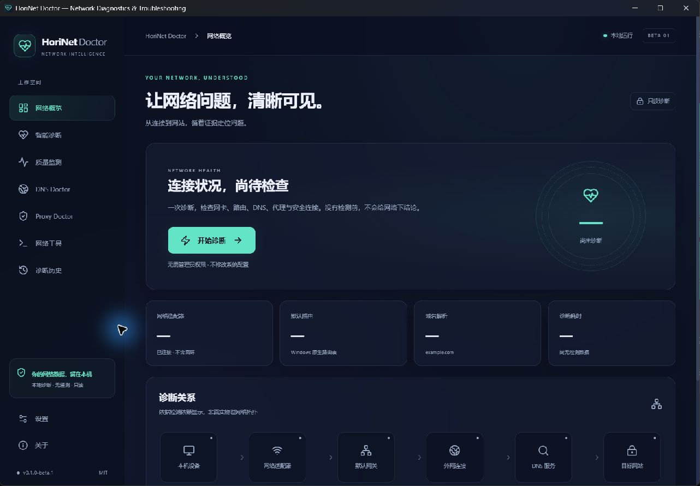

# HoriNet Doctor

**Network Diagnostics & Troubleshooting**

A free, local-first, read-only network diagnostics app for **Windows 10 / 11 x64**. Rust performs the actual network measurements; Tauri 2 and React display evidence and explain what to check next. Default language: 简体中文. English and light/dark themes are included.

[简体中文](README.zh-CN.md) · [Downloads](https://github.com/hhhoratioxu/HoriNet-Doctor/releases) · [User guide](docs/USER_GUIDE.md) · [Build guide](docs/BUILD.md) · [Architecture](docs/ARCHITECTURE.md)



Actual beta.1 Windows desktop screenshot (before the NAT page was added); the empty state contains no measurements or private network data.

[Real monitor screenshot](docs/images/desktop-monitor.png) · [English / light theme screenshot](docs/images/desktop-light-en.png)

## Download and install

Get the **Windows x64 `-setup.exe`** from [v0.1.0-beta.2](https://github.com/hhhoratioxu/HoriNet-Doctor/releases/tag/v0.1.0-beta.2). This is a **beta prerelease**, not a stable release. The NSIS installer installs for the current user. Microsoft Edge WebView2 Runtime is required; if absent the installer offers Microsoft's bootstrapper, which needs Internet access. The normal application does not need administrator privileges.

**Unsigned:** there is no code-signing certificate. Windows SmartScreen may warn; no signing certification is claimed. Verify the downloaded file against the release's `SHA256SUMS.txt`, for example `Get-FileHash .\HoriNet-Doctor_0.1.0-beta.2_windows-x64-setup.exe -Algorithm SHA256`. `BUILD-windows-x64.json` records the source commit, build target and CI run. A companion CLI is also available.

## Implemented in the beta

| Area | Real behavior |
| --- | --- |
| One-click diagnosis | Native adapters, Ethernet/Wi-Fi, IPv4/IPv6, DHCP/APIPA evidence, default routes/gateways, configured DNS, gateway ICMP, public-IP TCP connectivity, system resolution, UDP DNS, HTTP/HTTPS, verified TLS handshake, static proxy port, WLAN signal and short RTT sampling. 16 core checks with progress, timeout and cancellation; optional consented NAT discovery adds a 17th check. |
| Evidence-based rules | Adapter disconnected, DHCP/APIPA, missing default route, IP reachable/DNS failure, target HTTPS failure, asymmetric IPv4/IPv6, unreachable proxy port, possible proxy conflict, possible portal, weak Wi-Fi, elevated RTT/variation; evidence, possible causes, confidence and next steps. |
| Monitor / Ping | Native ICMP and TCP side by side, chart, minimum/maximum/mean RTT, no-reply rate, RTT delta, TCP time, sample count and elapsed time; pause/resume/stop. One target, 1.5 s default interval, 10,000-sample/24-hour limit; chart shows latest 180. |
| DNS Doctor | User-chosen domain and up to 3 DNS endpoints; A/AAAA over real UDP and TCP; optional wire-format DoH; time, records, truncation and explicit errors. Displayed system DNS does not include every split-DNS policy. |
| Proxy Doctor | Windows current-user static proxy, PAC/WPAD metadata, classic WinHTTP default proxy, heuristic virtual/TUN/VPN adapter detection; explicit HTTP CONNECT or unauthenticated SOCKS5 tunnel test. Save a diagnosis baseline and compare after a manual proxy change. |
| NAT Doctor | Real IPv4 UDP STUN / RFC 5780 mapping and filtering, conservative classic labels, confidence and evidence. Configurable server, consent before traffic, live probes/cancel, local history and masked/redacted endpoints. [Usage and limitations](docs/NAT.md). |
| Traceroute / TCP | Native IPv4/IPv6 ICMP TTL/hop-limit trace, one probe per hop, max 30 hops, unknown hops, cancellation, redacted copy/export; single IP:port TCP test. |
| Local history / reports | Structured diagnosis records, local retention, browse/delete/clear; JSON/Markdown exports and summary copy redact IPs, MACs, SSIDs, usernames and proxy settings by default. Detailed export requires explicitly checking the option. |
| Desktop | Ten pages, Simplified Chinese/English navigation and controls, dark/light glass interface, native title bar and keyboard focus. Windows backdrop support varies by OS; CSS backdrop blur also applies inside the app. |

The first screen is an empty state. It never invents a healthy connection or displays example measurements. The relationship diagram represents **diagnostic dependencies, not physical topology**. Scores use normal=100, warning=50 and error/unknown=0 averaged across collected checks; coverage and formula are visible, and an entirely unknown result has no score. A score is not Internet availability.

## Privacy and network behavior

- No telemetry, ads, paid API, repair action or diagnostic upload. STUN public mapped-IP discovery is off by default and requires explicit consent, including its optional one-click integration.
- Probes start only on user action. Review/change targets in Settings. Defaults: TCP `1.1.1.1:443`, IPv6 `[2606:4700:4700::1111]:443`, resolver test `example.com`, HTTP `www.msftconnecttest.com/connecttest.txt`, HTTPS `example.com`. DNS Doctor shows its endpoints (default Cloudflare/Google public DNS) before running; optional DoH defaults to Cloudflare. These services see ordinary request source addresses and queried domains.
- HTTP checks are deliberately plaintext to observe redirects; they send no credentials and never follow redirects. HTTPS/TLS tests validate certificates, use public WebPKI roots and bypass system/application HTTP proxies to expose the direct path. OS-level VPN/TUN routing still applies.
- NAT Doctor defaults to `stun.miwifi.com:3478`, visible and editable before consent. STUN recipients and their advertised alternate endpoints see the source IP. No undisclosed fallback server is used. NAT observations do not contribute to health scoring.
- PAC is not executed; no other app's accounts, subscriptions, passwords or tokens are read. Only a manually selected/configured proxy endpoint is tested; there is no automatic port scan.
- Detailed local history is stored in `%LOCALAPPDATA%\io.github.hhhoratioxu.horinet-doctor\history`, with user settings beside it. It is **not additionally encrypted**; Windows account permissions apply. Review any report before sharing, even after automatic redaction.
- No shell IPC, system network writes, admin manifest, remote web content or frontend network access. The local main window has an explicit command allowlist and restricted Tauri capabilities.

## Interpretation and known limits

- NAT type can remain unknown when the server lacks RFC 5780, the UDP path is unavailable or observations are inconsistent. Restricted filtering is inferred with low confidence. No console ratings, CGNAT/double-NAT proof or P2P guarantee. [NAT guide](docs/NAT.md).
- An ICMP timeout can mean filtering, and an unknown hop is not proof of a broken line. No-reply rate includes ICMP filtering and is not necessarily physical packet loss. Variation is the mean absolute difference of adjacent successful RTT samples.
- A single unreachable IP, site or port cannot establish an Internet-wide outage. Different DNS responses may reflect CDN, geography, caching or split DNS, and do not prove poisoning/interception.
- WLAN signal/SSID may be unknown when location permission is denied, WLAN AutoConfig is unavailable, or no Wi-Fi is connected. The app does not change Windows privacy permissions. DHCP is inferred from native configuration/address evidence, not a lease renewal.
- Classic WinHTTP configuration is not every application's effective proxy. PAC/authenticated proxy execution, interception, HTTPS-through-proxy content validation, arbitrary app internals, and automatic repair are outside this beta.
- Public TLS roots are bundled; enterprise private roots can cause a direct TLS failure. DoH bootstrap still uses system DNS. Raw UDP queries do not implement DNSSEC validation, DNS caching or automatic TCP retry (TCP results are shown separately).
- Scoped link-local IPv6 targets are not supported by the host-input form; use global IPv6 or loopback. Traceroute currently performs one probe per hop, no reverse DNS or path geolocation.
- macOS/Linux native adapters and installers are future work; they are not advertised as supported. Windows 10 physical-device and diverse VPN/enterprise network acceptance must be tracked separately from CI builds.

## Development and validation

See [build instructions](docs/BUILD.md), [recorded validation](docs/VALIDATION.md), [architecture](docs/ARCHITECTURE.md), [security](SECURITY.md) and [roadmap](docs/ROADMAP.md).

```powershell
npm --prefix desktop ci
npm --prefix desktop run build
cargo test -p horinet-core --locked
cargo clippy --workspace --all-targets --locked -- -D warnings
npm --prefix desktop run tauri -- build --bundles nsis -- --locked
```

Windows CI runs formatting, workspace Clippy/tests, `npm ci`, TypeScript, ESLint, production build and x64 NSIS packaging. Release tags rerun these checks, produce SHA-256/provenance, then publish an unsigned beta prerelease. No test result or screenshot is fabricated. This is independently written code; no unpublished HoriLink sources are included.

## License and contributions

[MIT](LICENSE). Contributions: [CONTRIBUTING.md](CONTRIBUTING.md). Community standards: [CODE_OF_CONDUCT.md](CODE_OF_CONDUCT.md). Report security issues privately using [SECURITY.md](SECURITY.md). Do not attach unredacted network reports to public issues.
